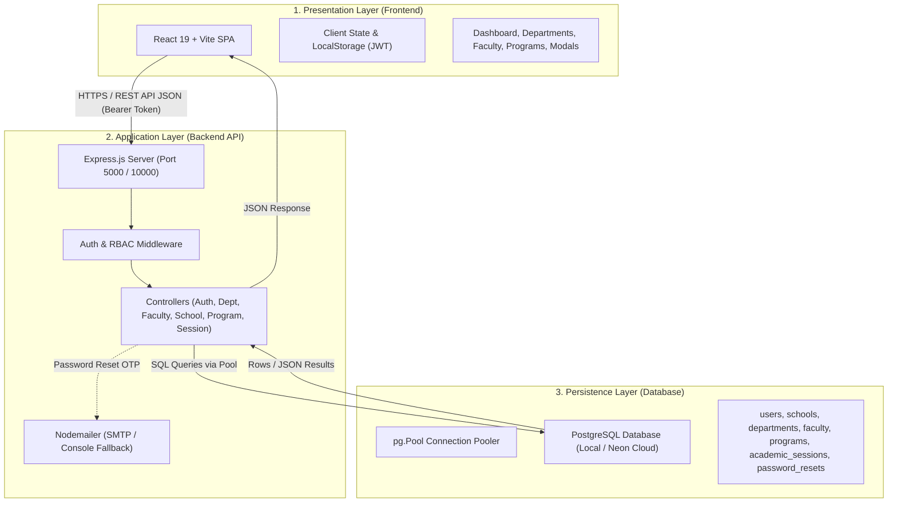
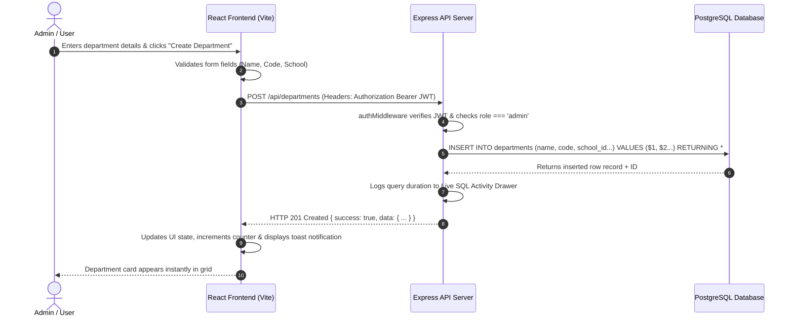
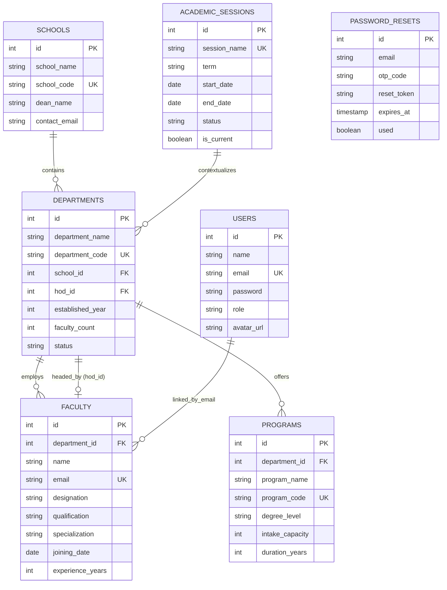
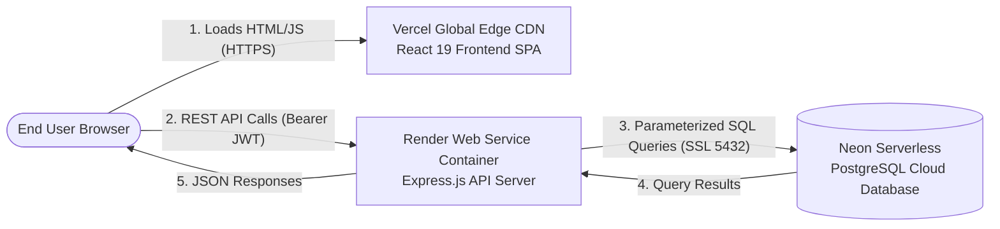

# 🏛️ NAVRACHANA UNIVERSITY (NUV) ERP
## Phase 2 Module 12: Department Management System
### 📖 Complete Architecture Manual & New User Guide

---

## 📑 Table of Contents
1. [Executive Summary & System Purpose](#1-executive-summary--system-purpose)
2. [End-to-End System Architecture](#2-end-to-end-system-architecture)
3. [Where Everything Runs (Local vs. Production)](#3-where-everything-runs-local-vs-production)
4. [Folder & File Structure Breakdown](#4-folder--file-structure-breakdown)
5. [Application Workflow & Request Lifecycle](#5-application-workflow--request-lifecycle)
6. [Database Architecture & Data Relationships](#6-database-architecture--data-relationships)
7. [Authentication, Security & Role-Based Permissions (RBAC)](#7-authentication-security--role-based-permissions-rbac)
8. [How to Run the Application (Step-by-Step Setup)](#8-how-to-run-the-application-step-by-step-setup)
9. [Feature & Module Walkthrough](#9-feature--module-walkthrough)
10. [Troubleshooting & FAQ](#10-troubleshooting--faq)
11. [Production Deployment Architecture](#11-production-deployment-architecture)

---

## 1. Executive Summary & System Purpose

The **Department Management System (Module 12)** is a mission-critical core module within the **Navrachana University (NUV) ERP Phase 2** ecosystem. It centralizes and automates academic administration across all schools, institutes, departments, programs, and faculty members under Navrachana University, Vadodara.

### Key Objectives
* **Unified Academic Hierarchy:** Maintains relational links between Schools $\rightarrow$ Departments $\rightarrow$ Academic Programs $\rightarrow$ Faculty Members.
* **Role-Based Access Control (RBAC):** Restricts data views and administrative actions based on four roles: **Admin / Superadmin**, **Dean**, **Head of Department (HOD)**, and **Faculty**.
* **Academic Session Auditing:** Enables historical and active session tracking (`2024–25`, `2025–26`, `2026–27`, `2027–28`).
* **Relational PostgreSQL Backend:** Backed by an ACID-compliant PostgreSQL database with automated indexing, cascading referential integrity, connection pooling, and live query inspection.
* **Modern Web UX:** Built with React 19, Vite, responsive glassmorphism dark/light UI, and client-side Excel exporting.

---

## 2. End-to-End System Architecture

The application follows a clean, decoupled **3-Tier Client-Server Architecture**:



### Component Roles & Responsibilities

| Layer | Technology | Primary Purpose |
| :--- | :--- | :--- |
| **Presentation Tier** | React 19, Vite, Lucide Icons, SheetJS (XLSX) | Renders responsive UI, handles user input, verifies token persistence, formats data tables, generates Excel downloads. |
| **Application Tier** | Node.js, Express 4.19, `pg`, `bcryptjs`, `cors` | Validates requests, authenticates JWTs, enforces department-scoping rules for HODs, executes parameterized SQL queries. |
| **Persistence Tier** | PostgreSQL 16/17 (Local / Neon Serverless) | Stores relational tables, handles foreign key cascading rules, enforces unique constraints, indexes query targets. |

---

## 3. Where Everything Runs (Local vs. Production)

```
┌────────────────────────────────────────────────────────────────────────────────────────┐
│                                 LOCAL DEVELOPMENT                                      │
├───────────────────┬───────────────────────────────┬────────────────────────────────────┤
│ Service           │ URL / Port                    │ Startup Command                    │
├───────────────────┼───────────────────────────────┼────────────────────────────────────┤
│ Frontend (Vite)   │ http://localhost:5173         │ cd frontend && npm run dev         │
│ Backend (Express) │ http://localhost:5000         │ cd backend && npm run dev          │
│ Database (Postgres)│ localhost:5432 (nuv_department_db)│ pg_ctl / Docker / Windows Service│
│ All-in-One Launch │ Launches both servers         │ .\start-all.bat                    │
└───────────────────┴───────────────────────────────┴────────────────────────────────────┘

┌────────────────────────────────────────────────────────────────────────────────────────┐
│                                LIVE PRODUCTION                                         │
├───────────────────┬───────────────────────────────┬────────────────────────────────────┤
│ Service           │ Hosting Platform              │ Live URL Pattern                   │
├───────────────────┼───────────────────────────────┼────────────────────────────────────┤
│ Frontend (Vite)   │ Vercel (Global Edge CDN)      │ https://your-project.vercel.app    │
│ Backend (Express) │ Render (Web Service Container)│ https://nuv-department-api.onrender.com│
│ Database (Postgres)│ Neon (Serverless PostgreSQL)  │ postgresql://neondb_owner:...      │
└───────────────────┴───────────────────────────────┴────────────────────────────────────┘
```

---

## 4. Folder & File Structure Breakdown

```
department-management/
├── database/                        # PostgreSQL DDL & Data Initialization
│   ├── schema.sql                   # Table definitions, constraints, indexes
│   └── seed.sql                     # Realistic NUV university sample datasets
│
├── backend/                         # Express.js REST API Server
│   ├── src/
│   │   ├── controllers/             # Business logic & request handling
│   │   │   ├── authController.js    # Login, password reset, OTP recovery
│   │   │   ├── dashboardController.js# Metrics, charts, SQL logs
│   │   │   ├── departmentController.js# Departments CRUD & HOD assignment
│   │   │   ├── facultyController.js # Faculty directory & profile management
│   │   │   ├── programController.js # Degree programs & intake capacities
│   │   │   ├── schoolController.js  # Schools/Institutes CRUD
│   │   │   └── sessionController.js # Academic session tracking
│   │   ├── db/
│   │   │   ├── database.js          # PostgreSQL Pool, auto-schema sync, query logging
│   │   │   └── seedRunner.js        # Node.js CLI script to reseed database
│   │   ├── middleware/
│   │   │   └── authMiddleware.js    # JWT & role verification
│   │   ├── routes/                  # Express route routers (`/api/*`)
│   │   ├── services/
│   │   │   └── emailService.js      # Nodemailer SMTP transporter
│   │   ├── utils/
│   │   │   └── security.js          # Password hashing & sanitization
│   │   └── server.js                # Express app entrypoint & middleware setup
│   ├── .env.example                 # Template for backend secrets
│   └── package.json                 # Backend dependencies & scripts
│
├── frontend/                        # React 19 + Vite Single Page Application
│   ├── public/                      # Static assets, logos, favicon
│   ├── src/
│   │   ├── components/              # Reusable UI widgets & Modals
│   │   │   ├── AcademicSessionModal.jsx
│   │   │   ├── ChangePasswordModal.jsx
│   │   │   ├── DeleteConfirmModal.jsx
│   │   │   ├── DepartmentModal.jsx
│   │   │   ├── FacultyModal.jsx
│   │   │   ├── Navbar.jsx & Sidebar.jsx
│   │   │   ├── Pagination.jsx & MultiSelectDropdown.jsx
│   │   │   └── SqlInspector.jsx     # Live PostgreSQL query activity drawer
│   │   ├── pages/                   # Full application views
│   │   │   ├── Dashboard.jsx        # Statistics cards, charts, summaries
│   │   │   ├── Departments.jsx      # Grid/list of departments
│   │   │   ├── DepartmentProfile.jsx# Detailed department view with programs & staff
│   │   │   ├── FacultyDirectory.jsx # Searchable faculty directory
│   │   │   ├── Programs.jsx         # Academic degree programs list
│   │   │   ├── Schools.jsx          # Schools & institutes overview
│   │   │   └── Login.jsx            # Authentication & OTP password reset
│   │   ├── services/
│   │   │   ├── api.js               # Centralized Fetch client with JWT interceptor
│   │   │   └── permissions.js       # Client-side RBAC guard rules
│   │   ├── utils/
│   │   │   └── excelExporter.js     # Formatted XLSX spreadsheet exporter
│   │   ├── App.jsx                  # Navigation, routing & authentication state
│   │   ├── index.css                # Design system tokens & global styling
│   │   └── main.jsx                 # React root renderer
│   ├── .env.example                 # Frontend env template
│   ├── .env.production              # Production API URL configuration
│   ├── vercel.json                  # SPA client rewrite rules for Vercel
│   └── package.json                 # Frontend dependencies & scripts
│
├── start-all.bat                    # One-click Windows batch script to launch both servers
├── .gitignore                       # Prevents committing secrets or node_modules
└── README.md                        # Project documentation
```

---

## 5. Application Workflow & Request Lifecycle

Here is the exact lifecycle of how an action (e.g., creating a new Department) flows from user interaction to database persistence:



---

## 6. Database Architecture & Data Relationships

### Entity-Relationship Diagram (ERD)



### Relational Integrity Rules
1. **Cascade Deletes:** Deleting a `department` automatically removes associated records in `faculty` and `programs` via `ON DELETE CASCADE`.
2. **Nullify on Delete:** Deleting a `school` sets `departments.school_id` to `NULL` (`ON DELETE SET NULL`), preserving department historical data.
3. **Circular Foreign Key Handled Safely:** `departments.hod_id` points to `faculty.id`, and `faculty.department_id` points to `departments.id`. Initial creation uses a two-phase `ALTER TABLE` constraint.

---

## 7. Authentication, Security & Role-Based Permissions (RBAC)

The system implements strict **Role-Based Access Control** enforced both at the UI layer and at the API controller layer:

### Role Permissions Matrix

| Module / Action | Admin / Dean | Head of Department (HOD) | Faculty Member |
| :--- | :---: | :---: | :---: |
| **View Dashboard & Metrics** | ✅ All University Data | 🟡 Scoped to Own Department | 🟡 Department Overview |
| **Manage Schools** | ✅ Full CRUD | ❌ Read-Only | ❌ Read-Only |
| **Create/Edit/Delete Departments**| ✅ Full CRUD | ❌ Read-Only | ❌ Read-Only |
| **Assign HOD to Department** | ✅ Yes | ❌ No | ❌ No |
| **Add / Edit Faculty** | ✅ Any Department | 🟡 Own Department Only | ❌ Own Profile View |
| **Add / Edit Academic Programs** | ✅ Any Program | 🟡 Own Department Only | ❌ Read-Only |
| **Manage Academic Sessions** | ✅ Create & Set Active | ❌ View Only | ❌ View Only |
| **Export to Excel** | ✅ Global Reports | ✅ Department Reports | ✅ Directory Export |
| **View Live SQL Query Logs** | ✅ Admin Only | ❌ Hidden | ❌ Hidden |

### Default Test Credentials (Seed Data)

| Role | Email Address | Password | Department Scoping |
| :--- | :--- | :--- | :--- |
| **System Admin** | `admin@nuv.ac.in` | `admin123` | Full University Access |
| **Dean Academic** | `dean.academic@nuv.ac.in` | `admin123` | Full University Access |
| **HOD (CSE Dept)** | `rajesh.sharma@nuv.ac.in` | `admin123` | Scoped to Computer Science & Engineering |
| **HOD (Mech Dept)**| `vikram.rathod@nuv.ac.in` | `admin123` | Scoped to Mechanical Engineering |
| **Faculty (CSE)** | `priya.desai@nuv.ac.in` | `admin123` | Read-only CSE Staff Member |

---

## 8. How to Run the Application (Step-by-Step Setup)

### Prerequisites
* **Node.js**: v18.0.0 or higher
* **PostgreSQL**: v14.0.0 or higher (or a free Neon Cloud Database URL)
* **Git**: Installed

---

### Option A: Quick Launch with Batch File (Windows)
Double-click [`start-all.bat`](file:///c:/Users/Lenovo/OneDrive%20-%20pdpu.ac.in/Desktop/Department%20Managment/start-all.bat) in the root directory. It will automatically start both the Backend and Frontend servers in separate command windows.

---

### Option B: Manual Terminal Execution

#### 1. Setup Backend
Open a terminal in the root folder:
```powershell
cd backend
npm install
```
Create a `backend/.env` file with your database credentials:
```env
PORT=5000
NODE_ENV=development
PGUSER=postgres
PGPASSWORD=your_postgres_password
PGHOST=localhost
PGPORT=5432
PGDATABASE=nuv_department_db
PGSSL=false
JWT_SECRET=your_development_jwt_secret_key_12345
```
Seed the database:
```powershell
npm run seed
```
Start the backend server:
```powershell
npm run dev
```
*(Backend runs at `http://localhost:5000`)*

---

#### 2. Setup Frontend
Open a second terminal window:
```powershell
cd frontend
npm install
npm run dev
```
*(Frontend runs at `http://localhost:5173`)*

---

## 9. Feature & Module Walkthrough

```
┌──────────────────┐     ┌─────────────────────────────────────────────────────────────┐
│ Sidebar Menu     │     │ Main Workspace View                                         │
├──────────────────┤     ├─────────────────────────────────────────────────────────────┤
│ 📊 Dashboard     │ ──> │ Real-time KPI Cards, School Distribution, Session Selector │
│ 🏢 Schools       │ ──> │ Institute directory (SET, SBL, SEDA, SLAE, SOS)             │
│ 🏛️ Departments   │ ──> │ Department Cards, Search, Filters, Add Dept, Edit, Export   │
│ 👨‍🏫 Faculty       │ ──> │ Faculty Roster, Specialization Tags, Designation Badges     │
│ 📚 Programs      │ ──> │ Degree levels (B.Tech, M.Tech, MBA, Ph.D) & Intakes         │
│ 🗓️ Sessions      │ ──> │ Academic Year Management (Archive / Active / Upcoming)      │
│ ⚙️ SQL Activity   │ ──> │ Live query performance drawer with execution time in ms     │
└──────────────────┘     └─────────────────────────────────────────────────────────────┘
```

1. **Academic Session Switching:** Selecting a session from the top-bar dropdown filters student counts, active programs, and statistics without reloading the page.
2. **Department Profile Page:** Clicking on any department card opens its deep profile page showing its assigned HOD, enrolled faculty, offered degree programs, building location, and contact information.
3. **Excel Export Engine:** Clicking **Export to Excel** in any table downloads a cleanly formatted `.xlsx` workbook generated natively in the browser via SheetJS.
4. **Password Recovery Flow:** If a user clicks **Forgot Password?** on the login screen:
   * Enters their registered institutional email (`@nuv.ac.in`).
   * A 6-digit cryptographic OTP is generated and emailed (or displayed in server logs in development mode).
   * Verifies the OTP and securely updates their password with Bcrypt hashing.

---

## 10. Troubleshooting & FAQ

| Symptom / Error | Root Cause | Exact Solution |
| :--- | :--- | :--- |
| **`ECONNREFUSED 127.0.0.1:5432`** | PostgreSQL is not running locally. | Start the PostgreSQL service via Windows Services (`services.msc`) or pgAdmin. |
| **`NetworkError when attempting to fetch`** | Frontend is trying to reach a different port/URL. | Check `frontend/.env.production` or verify backend server is running at port 5000. |
| **`Cross-Origin Request Blocked (CORS)`** | Backend missing CORS headers. | In `backend/src/server.js`, verify `app.use(cors({ origin: '*' }))` is present. |
| **`404 on page refresh on Vercel`** | Single Page Application (SPA) routing. | Ensure [`frontend/vercel.json`](file:///c:/Users/Lenovo/OneDrive%20-%20pdpu.ac.in/Desktop/Department%20Managment/frontend/vercel.json) rewrite rule is present in the repository. |
| **`password authentication failed for user`** | Wrong database password in `.env`. | Open `backend/.env` and update `PGPASSWORD` with your actual PostgreSQL password. |

---

## 11. Production Deployment Architecture



### Production Checklist
1. **Database:** Hosted on **Neon Serverless PostgreSQL** with automated connection pooling and SSL encryption (`sslmode=require`).
2. **Backend:** Hosted on **Render** with auto-deploy on `git push`, environment secrets (`DATABASE_URL`, `JWT_SECRET`), and health check endpoint at `/api/health`.
3. **Frontend:** Hosted on **Vercel** with automatic Vite builds and client-side rewrites for clean URL routing.

---

*Document prepared for Navrachana University (NUV) ERP Engineering Team.*
